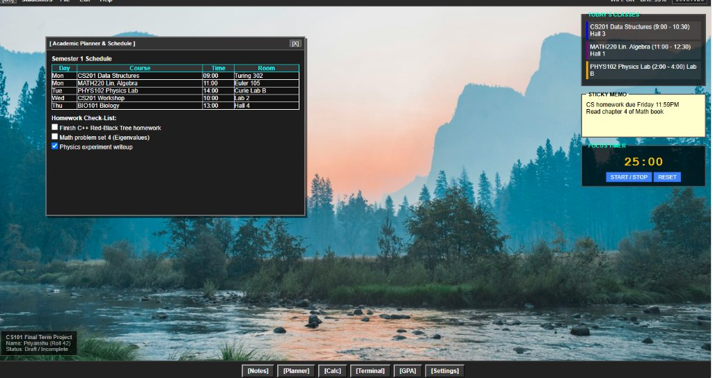

# StudentOS

A lightweight macOS-inspired web desktop built using pure HTML, CSS, and vanilla JavaScript. No frameworks, npm packages, or build tools required.



## Why I Built This

I wanted a simple desktop dashboard to keep open on my second monitor while studying. Most study sites and productivity apps are filled with subscriptions or ads, so I decided to build a minimal desktop environment that runs locally in the browser with the tools I actually use for college.

## Features

- **Window Management**: Draggable windows with basic close and focus controls.
- **Academic Planner**: Weekly class timetable and homework checklist.
- **Notes App**: Simple scratchpad for lecture notes with localStorage persistence.
- **Calculator**: Basic grid layout for quick math homework.
- **Focus Timer**: 25-minute Pomodoro timer with start, stop, and reset.
- **Terminal CLI**: Mock terminal shell with basic commands (`help`, `ls`, `whoami`, `date`, `clear`, `echo`).
- **GPA Tracker**: Course grade breakdown and cumulative GPA calculator.
- **Desktop Widgets**: Side widget area for urgent reminders, today's schedule, and sticky notes.
- **Settings**: Wallpaper switcher that updates the background image.

## How to Run

1. Clone or download this repository:
   ```bash
   git clone https://github.com/priyanshusingh1234/web-os.git
   ```
2. Open `index.html` directly in any web browser (Chrome, Edge, Firefox).
3. No dependencies or server setup required.
